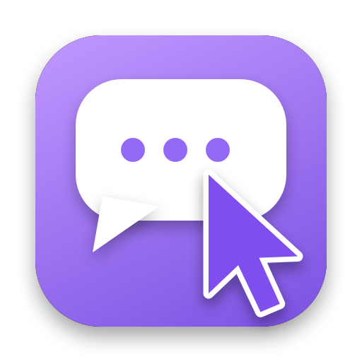

<p align="center">
  
</p>

<h1 align="center">uuchat</h1>

<p align="center">
  <b>给「网易 UU 远程」被控 Mac 用的浮窗聊天 + 键鼠接管工具</b><br>
  别人远程控制你的 Mac 时,他的键盘和鼠标不再抢你的焦点和光标 ——<br>
  键盘进屏幕左下角的聊天浮窗(自带拼音组词),鼠标变成一个独立的紫色光标。
</p>

---

> **English:** uuchat is a macOS menu-bar utility for the *controlled* side of NetEase UU Remote. It intercepts the keyboard/mouse events injected by `UURemoteServer` so the remote user types into a floating chat window (with a built-in Rime pinyin IME) and moves a separate purple cursor, while the host keeps using the real keyboard and cursor undisturbed. macOS 13+, Apple Silicon & Intel.

## 它解决什么问题

UU 远程控制时,远端的按键和鼠标事件会直接注入本机系统:

- 远端打字 → 打进你当前的窗口,和你自己的输入混在一起,而且远端**没有输入法**,打不了中文
- 远端动鼠标 → 直接拽走你的真光标,你俩互相抢

uuchat 把这些注入事件拦下来,各走各的:

| | 主机(你) | 远端(UU) |
|---|---|---|
| 键盘 | 照常用,零影响 | 进浮窗的「远端」输入卡片,内嵌 Rime 拼音组词,数字/空格选词,↵ 提交 |
| 鼠标 | 真光标不受影响 | 一个紫色 **UU** 光标;点击、拖动、滚轮在紫色光标处生效 |
| 聊天 | 底部输入条发消息(绿) | 提交的消息进共享历史(紫) |

## 安装

1. 从 [Releases](../../releases/latest) 下载 `uuchat-x.y.z.dmg`(或 zip),把 **uuchat** 拖进「应用程序」
2. **拼音引擎自动获取**:首次启动若没有引擎,会弹窗询问是否下载(约 25 MB)。它从 GitHub [rime/squirrel](https://github.com/rime/squirrel/releases) 官方发布页拉取安装包,**校验 Apple Developer ID 签名**后只解出 `librime` 和词库到 `~/Library/Application Support/uuchat/engine`,不会安装鼠鬚管输入法,也不需要管理员密码。之后也可以在 设置 → 运行状态 → 拼音引擎 点「一键安装」。已经装了鼠鬚管的话会直接复用,不用下载
3. **首次打开**:App 没有 Apple 开发者签名(ad-hoc 签名),macOS 会拦。任选其一:
   - 右键 uuchat → 打开 → 打开
   - 或终端执行:`xattr -dr com.apple.quarantine /Applications/uuchat.app`
4. 系统设置 → 隐私与安全性 → **辅助功能** → 打开 uuchat(用来创建键鼠拦截 tap)。授权后无需重启,自动生效

> ⚠️ 每次更新 App 后,macOS 会因为签名变化让辅助功能授权失效:在辅助功能里把 uuchat 先移除再重新添加即可。

要求:macOS 13+,Apple Silicon / Intel 通用二进制。

## 使用

- 菜单栏 💬 图标:显示/隐藏浮窗、接管开关、设置、退出(浮窗上右键是同一份菜单)
- 浮窗顶栏:⌨ 键盘接管、🖱 鼠标接管、`● 接管中` 总开关(紫色=开,灰/橙=关)
- **`⌘⌥G`** 全局快捷键:接管 ↔ 放行。放行时 UU 键鼠恢复原生行为
- 远端键盘:字母组词 → 候选条显示在输入卡片上方;`1-5`/空格选词;`↵` 先确认组词,再按一次 `↵` 发送;`Esc` 清空;手机端直接注入的中文文本绕过组词直接进框
- 主机可点「代发」替远端提交
- **设置**(菜单栏 → 设置…):键盘/鼠标接管、窗口置顶/透明度/提示音、开机自启、调试日志,以及辅助功能权限 / 拼音引擎 / UU 进程的实时状态

## 工作原理

- `CGEventTap`(HID 层, defaultTap)全局监听键鼠。事件里的 `kCGEventSourceUnixProcessID` 为 0 = 真实硬件,一律放行;等于 `UURemoteServer` 的 pid(自动发现)= 远端注入,按设置接管
- **拼音**:运行时 `dlopen` `librime`(BSD),优先用 uuchat 自己下载的引擎(`…/uuchat/engine`),其次系统里已装的鼠鬚管;用户词库在 `~/Library/Application Support/uuchat/rime-user`,默认简化字 `luna_pinyin_simp`;构建时不依赖 Squirrel
- **鼠标(双光标)** 有几个实测出来的坑:
  - UU 不止发鼠标事件,还会**直接 warp 真光标**到远端位置(非事件,tap 拦不住);空闲时还以约 8Hz 注入"当前光标位置"的回声
  - 做法:自己维护主机光标位置 `hostPos`,每个远端事件后立刻 warp 回 `hostPos`;落在 `hostPos` 2px 内的远端事件视为回声,不覆盖紫光标;远端点击/滚轮在紫光标坐标 `CGEventPost` 补发后再 warp 回
  - 主机位移同样被 warp 污染(窗口服务器的 delta = 光标位置差)。用 HID 无加速原始位移(`kCGEventUnacceleratedPointerMovementX/Y`)+ 实测加速增益表判别并还原,避免主机光标被"传送"到紫色光标
- 离线仿真:[`sim/sim.py`](sim/sim.py) 注入同款污染,对比各估计器的漂移和单步误差(改鼠标估计算法先在这里调参)
- 测试钩子:`/tmp/uuhook/fake_pids` 写入逗号分隔 pid,可把任意进程当作"远端注入源"(配合自写注入器做回归)

## 从源码构建

需要 Xcode Command Line Tools(`xcode-select --install`)。

```bash
git clone https://github.com/Chr0mium24/uuchat.git && cd uuchat
scripts/build.sh 1.0.0        # → build/uuchat.app, dist/uuchat-1.0.0.{zip,dmg}
```

```
Sources/        Swift 源码(单进程 AppKit, 无第三方依赖)
  main.swift          入口与 UU 进程探测
  EventTap.swift      全局键鼠 tap / 热键 / 辅助功能权限
  RemoteMouse.swift   紫色光标、补发、warp 污染对策
  RimeEngine.swift    dlopen librime、组词
  ChatWindow.swift    浮窗 UI
  SettingsWindow.swift / StatusMenu.swift / Settings.swift
include/        librime 的 C 头(BSD)+ module.modulemap
Resources/      Info.plist、AppIcon
scripts/        build.sh、make_icon.swift(程序化生成图标)
sim/            鼠标污染离线仿真
```

## 已知限制

- 只拦键鼠;手柄、触控板手势等不拦
- 远端无中文标点符号栏(跟随 rime 配置)
- 多显示器:光标坐标限制在所有显示器的并集内,未对异形排布做特殊处理
- 污染模型来自对 UU 实测日志的分析,不同 UU 版本行为可能不同;遇到光标异常可在设置里开「调试日志」,把 `/tmp/uuchat-mouse.log` 贴到 issue
- 非官方项目,与网易 UU 无关

## License

[MIT](LICENSE)。`include/rime_api.h` 来自 [librime](https://github.com/rime/librime),BSD 许可。
